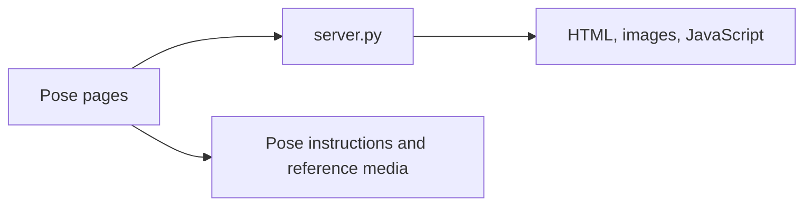

# Yoga Pose Model

A Flask service and browser-based yoga pose experience. It serves pose pages and uses `server.py` for HTTP delivery; `app.js` and HTML files provide the interactive client experience.

## Architecture



## Run locally

```bash
pip install -r requirements.txt
python server.py
# or use the Procfile command with gunicorn
```

The server binds to the host/port selected by the runtime. `DEPLOYMENT_GUIDE.md` and `replit.md` contain project-specific hosting notes.

## Data and deployment

Pose content is stored in repository HTML and image assets; there is no documented database API. Deploy the Flask app with Gunicorn on a Python host and serve media from a persistent/static location.

## Validation and limitations

No automated tests are configured. Check every pose route, media path, responsive layout, and server startup. The repository does not document a validated clinical or computer-vision accuracy guarantee; treat the content as educational.

## Security and operations

- Keep credentials, database URLs, OAuth tokens, API keys, and signing secrets in environment variables; never commit them.
- Validate and constrain uploaded files and user input at the server boundary, and enable HTTPS in production.
- Review dependency updates and rotate any credential that has appeared in repository history.

## Testing

The repository currently has no comprehensive automated test suite unless noted above. Before production changes, add tests for authentication/authorization, validation failures, persistence errors, and the primary user workflow.

## Limitations and roadmap

This is an actively evolving project. Production hardening, observability, rate limiting, backup/retention policy, and accessibility/performance validation should be completed before handling sensitive or high-volume workloads.

## License

See the repository license file and package metadata for the authoritative terms.
## Implementation notes

`server.py` serves the browser experience; pose-specific HTML pages and reference images remain repository assets, while `app.js` supplies client-side interaction. `Procfile`, `start.sh`, and `start.bat` describe alternate launch environments. This repository does not contain a documented trained-model artifact or inference API; the name should not be read as a clinical pose-classification guarantee.

### Verification

Install `requirements.txt`, start `python server.py`, and check every linked pose page, image path, responsive layout, and server error response. No automated test command is configured.

### License status

No dedicated license file is present in the inspected tree; license terms are unspecified.
